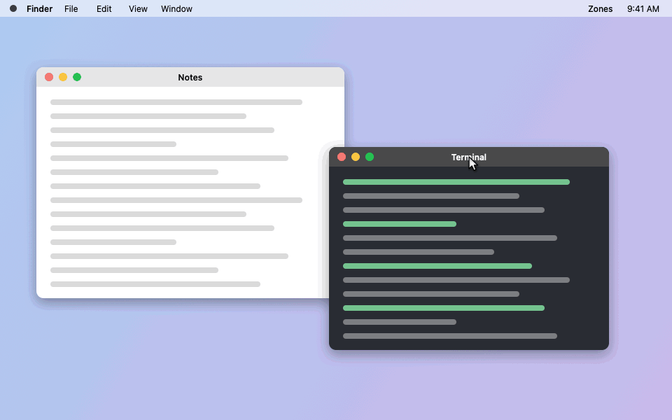

# Zones

A menu-bar window manager for macOS that snaps windows into Zone Layouts, in the style of FancyZones.

> **STATUS: Pre-release (0.1.0).** Built and unit-tested (330+ tests), but live drag-and-snap has not yet
> been verified on real hardware. Expect bugs. See [docs/STATUS.md](docs/STATUS.md).



*Rendered frames from the app's own views, not a screen recording.*

## Contents

- [Requirements](#requirements)
- [Install](#install)
- [Permissions](#permissions)
- [Usage](#usage)
- [Shortcuts](#shortcuts)
- [Layouts](#layouts)
- [Troubleshooting](#troubleshooting)
- [Contributing](#contributing)
- [License](#license)

## Requirements

- macOS 14 (Sonoma) or later.
- Apple silicon or Intel. The release build is universal (arm64 and x86_64).
- To build from source: Xcode with Swift 6.2 or later, and Homebrew (for `xcodegen`).

## Install

### Option A: DMG from GitHub Releases

1. Download `Zones-0.1.0.dmg` from the [Releases page](https://github.com/wakeupdg/zones/releases).
2. Open the DMG and drag `Zones.app` to `/Applications`.
3. The app is ad-hoc signed, not notarized. macOS blocks the first open. Use one of these:
   - In Finder, right-click `Zones.app` and choose **Open**, then confirm.
   - Or remove the quarantine flag in Terminal:

     ```sh
     xattr -dr com.apple.quarantine /Applications/Zones.app
     ```

### Option B: Homebrew cask

The cask lives in this repository at [Casks/zones.rb](Casks/zones.rb). It downloads the DMG from GitHub Releases.
Homebrew only installs casks from a tap, so tap this repository first:

```sh
brew tap wakeupdg/zones https://github.com/wakeupdg/zones
brew install --cask wakeupdg/zones/zones
```

Notes:

- `brew install --cask ./Casks/zones.rb` does not work. Current Homebrew rejects casks outside a tap.
- There is no separate `homebrew-zones` tap repository. The command above uses this repository as the tap.
- The same first-open rule as Option A applies, because the app is ad-hoc signed.

### Option C: Build from source

```sh
git clone https://github.com/wakeupdg/zones.git
cd zones
scripts/bootstrap.sh      # installs xcodegen if missing, generates the project, runs swift build
scripts/dev-cert.sh       # creates the "Zones Dev" signing identity once (bootstrap runs it on a terminal)
```

Why `dev-cert.sh`: an ad-hoc signature changes on every build, and macOS then drops the Accessibility grant.
The stable "Zones Dev" identity keeps the grant across rebuilds. It lives in its own keychain and does not
touch your login identities. See [ADR-0025](docs/adr/0025-dev-signing-identity.md).
Run `scripts/dev-cert.sh --dry-run` to see the plan without changing anything.

Build the app (the same command the merge gate uses):

```sh
xcodegen generate
scripts/dev-cert.sh --unlock   # the dev keychain locks itself after 1 hour
xcodebuild -quiet -project Zones.xcodeproj -scheme Zones -configuration Debug -derivedDataPath .build/DerivedData CODE_SIGN_IDENTITY="Zones Dev" build
open .build/DerivedData/Build/Products/Debug/Zones.app
```

Run the unit tests:

```sh
swift test
```

## Permissions

Zones asks for **Accessibility** and nothing else.

Why it needs Accessibility:

1. To move and resize windows that belong to other apps.
2. To watch mouse drags and modifier keys with a **listen-only** event tap. The tap can read events but never
   changes or blocks them.

What it does not use:

- No Screen Recording. Zones never reads window titles or window contents.
- No network access. Zones makes no network calls.

See [ADR-0020](docs/adr/0020-accessibility-is-the-only-permission.md) and
[ADR-0021](docs/adr/0021-onboarding-and-permission-loss.md).

### How to grant

1. Launch Zones. An onboarding window opens: "Zones needs Accessibility access".
2. Click **Open System Settings**. This opens **System Settings > Privacy & Security > Accessibility**.
3. Turn on **Zones** in the list.
4. Zones checks about once a second. When it sees the grant, it closes the onboarding window and starts
   listening for drags. The onboarding window also has a cheat sheet page (click **Next**).

If Zones launched at login, no window opens. The menu bar icon gets a red dot and the menu shows
**Grant Accessibility…** instead.

### The red dot on the menu bar icon

The red dot means Zones cannot snap right now. It shows when either:

- Accessibility is not granted, or was turned off while Zones was running, or
- the event tap is not running (for example, macOS disabled it and Zones could not bring it back).

The dot goes away when permission is granted and the event tap is alive.
If permission comes back but the tap still cannot be recreated, the onboarding window offers **Quit and Reopen**.

### How to reset the permission

Use this when the grant looks stuck, or after you switch between a DMG build and a source build.

1. Quit Zones.
2. Run:

   ```sh
   tccutil reset Accessibility com.dganesh.zones
   ```

3. Open Zones again and grant Accessibility again.

You can also re-run onboarding from **Settings > General > Re-run onboarding**.

## Usage

Zones lives in the menu bar. It has no Dock icon.

Default modifiers (change them in **Settings > General > Modifier keys**; the two must differ):

| Modifier | Default | What it does |
|---|---|---|
| Activation Modifier | Shift | Hold it while you drag a window to show the Zones overlay. |
| Span Modifier | Control | Hold it as well to grow the drop area over every Zone the cursor touches. |

### Snap a window

1. Start dragging a window by its title bar.
2. Hold **Shift** (the Activation Modifier). The Zones of that Display appear.
3. Move over a Zone. It highlights.
4. Release the mouse. The window snaps to that Zone.

A drop on a Gap, Margin or the empty surround snaps to the nearest Zone. A plain drag without the modifier
never snaps.

### Span several Zones

While you hold Shift during the drag, also hold **Control** (the Span Modifier). Every Zone the cursor
touches is added. The window snaps to the rectangle that covers all of them.

### Restore a window

Zones remembers a window's frame from before its first Snap (the Original Frame). To go back to it:

- With the mouse: drag with Shift held and drop outside the Display's visible frame (on the menu bar or the
  Dock strip).
- With the keyboard: press the Restore shortcut (Control + Option + R).

### Menu bar menu

- The Display under the cursor and its current Layout.
- A Layout list to pick the Layout for that Display.
- **Never Snap <app>** for the frontmost app.
- **Edit Layouts…**, **Settings…**, **About Zones**, **Quit Zones**.

### Settings

| Pane | What it holds |
|---|---|
| General | Permission and event tap status, Re-run onboarding, Modifier keys, Launch at Login |
| Layouts | Assignments per Display, custom Layouts (Duplicate, Rename, Delete, Export), Import and export |
| Shortcuts | One recorder per action |
| Appearance | Zone fill color and opacity, default Margin and Gap, Enhanced UI handling |
| Exclusions | Apps that Zones never snaps |
| About | Version, build, signing identity, license |

Each Display keeps its own Layout, keyed by the Display's UUID. A Display you unplug keeps its Assignment and
gets it back when you plug it in again. Layouts are per Display, not per Space.

## Shortcuts

Defaults come from `Preferences.defaultShortcuts` in
[Sources/ZonesCore/Preferences.swift](Sources/ZonesCore/Preferences.swift). Change or clear any of them in
**Settings > Shortcuts**. A shortcut must include Command or Control.

| Action | Default keys |
|---|---|
| Send focused window to Zone 1 | Control + Option + 1 |
| Send focused window to Zone 2 | Control + Option + 2 |
| Send focused window to Zone 3 | Control + Option + 3 |
| Send focused window to Zone 4 | Control + Option + 4 |
| Send focused window to Zone 5 | Control + Option + 5 |
| Send focused window to Zone 6 | Control + Option + 6 |
| Send focused window to Zone 7 | Control + Option + 7 |
| Send focused window to Zone 8 | Control + Option + 8 |
| Send focused window to Zone 9 | Control + Option + 9 |
| Move to the next Zone (cycle right, wraps) | Control + Option + Right Arrow |
| Move to the previous Zone (cycle left, wraps) | Control + Option + Left Arrow |
| Restore the Original Frame | Control + Option + R |
| Open the layout editor | Control + Option + E |
| Open Settings | Control + Option + , (comma) |

The window shortcuts (send, cycle, restore) are registered only while Accessibility is granted.
The editor and Settings shortcuts always work. See [ADR-0010](docs/adr/0010-default-shortcuts.md).

## Layouts

A Layout is a tree of splits. Each leaf is one Zone. Zone Numbers are derived from the tree in row-major
order and are never stored ([ADR-0003](docs/adr/0003-layout-is-a-split-tree.md),
[ADR-0004](docs/adr/0004-zone-numbering-row-major.md)).

### Built-in templates

From [Sources/ZonesLayout/Templates.swift](Sources/ZonesLayout/Templates.swift):

| Template | Zone counts | Shape |
|---|---|---|
| Columns | 2, 3, 4, 5 | Equal side-by-side Zones |
| Rows | 2, 3, 4, 5 | Equal stacked Zones |
| Grid | 4, 9 | 2 x 2 or 3 x 3 |
| Priority Grid | 3 | Side by side at 25 / 50 / 25 percent |
| Focus | 1 | One centered Zone (20 percent surround on each side) |

That is 12 built-in Layouts. A Display with no Assignment uses **Priority Grid**
([ADR-0005](docs/adr/0005-templates-and-default-layout.md)). Built-ins are never written to disk.

### Layout editor

Open it with **Edit Layouts…** in the menu or Control + Option + E. Click a Zone to select it, or a divider to
select that split. Drag a divider to resize; it snaps to nearby positions unless you hold Option.

| Key | Action |
|---|---|
| H | Split the selected Zone side by side |
| V | Split the selected Zone stacked (top and bottom) |
| M | Merge the selected Zone with its sibling (both must be Zones) |
| Arrow keys | Nudge the selected divider by 1 point |
| Shift + Arrow keys | Nudge the selected divider by 10 points |
| Command + Z | Undo |
| Command + Shift + Z | Redo |
| Command + S | Save |
| Command + W | Close the editor |
| Command + Shift + A | Assign this Layout to the Display being edited |

The toolbar also has a Display picker, a Template picker, and Margin and Gap sliders.
Keys come from [App/Editor/EditorKeyHandling.swift](App/Editor/EditorKeyHandling.swift).

### Files on disk

Zones keeps its documents in `~/Library/Application Support/Zones/`:

| File | Holds |
|---|---|
| `layouts.json` | Custom Layouts only (`version`, `layouts`) |
| `assignments.json` | Which Layout each Display uses (`version`, `assignments`, keyed by Display UUID) |
| `enhanced-ui-recovery.json` | Short-lived record of apps whose Enhanced UI Zones turned off, so the next launch can turn it back on |

Preferences (modifiers, shortcuts, appearance, exclusions) are a JSON value in UserDefaults under the key
`zones.preferences` (`~/Library/Preferences/com.dganesh.zones.plist`).

Rules ([ADR-0017](docs/adr/0017-json-persistence.md)):

- Every write is atomic.
- The document version is the top-level `version` field. The current version is 1.
- An older file is migrated. The original is first saved as `<name>.<yyyyMMdd-HHmmss>.bak`.
- A file that cannot be read is moved aside as `<name>.<yyyyMMdd-HHmmss>.corrupt` and Zones starts with defaults.
- A file with a newer version than this build supports is left untouched.

### Layout JSON format

This is a real `layouts.json` (the first Layout of the test fixture
[Tests/ZonesCoreTests/Fixtures/layouts.v1.json](Tests/ZonesCoreTests/Fixtures/layouts.v1.json)).
It decodes and re-encodes to the same value:

```json
{
  "version": 1,
  "layouts": [
    {
      "id": "37D8832A-2D66-02CA-B9F7-8F30A301B230",
      "name": "Desk",
      "surround": { "top": 0, "left": 0, "bottom": 0, "right": 0 },
      "insets": { "margin": 8, "gap": 8 },
      "root": {
        "kind": "split",
        "axis": "horizontal",
        "ratio": 0.5,
        "first": { "kind": "leaf" },
        "second": {
          "kind": "split",
          "axis": "vertical",
          "ratio": 0.5,
          "first": { "kind": "leaf" },
          "second": { "kind": "leaf" }
        }
      }
    }
  ]
}
```

Field notes:

- `id`: a UUID string for a custom Layout. Built-ins use ids like `builtin:priorityGrid:3` and are never stored.
- `root`: a node. `{"kind": "leaf"}` is one Zone. A split has `axis`, `ratio`, `first` and `second`.
- `axis`: `horizontal` means side by side (`first` is left). `vertical` means stacked (`first` is top).
- `ratio`: the share of `first`, between 0 and 1. Every Zone must be at least 1/12 of the width and height.
- `surround`: the fraction of the visible frame left empty on each side (0 for most Layouts, 0.2 for Focus).
- `insets.margin`: points between the Zones and the edge. `insets.gap`: points between Zones.

The example above is one Zone on the left half and two stacked Zones on the right half.

### Import and export

In **Settings > Layouts > Import and export**:

- **Export all…** writes every custom Layout and every Assignment to one JSON file.
- **Export…** on a single Layout writes that Layout and the Assignments that use it.
- **Import…** reads a file and asks for **Merge** (keep yours, add these, rename clashes) or **Replace**
  (take the file whole; a backup of both current documents is written first).
- Every incoming Layout is validated. One bad Layout refuses the whole file.

## Troubleshooting

- **Red dot stays after you granted access.** The grant may belong to an older build. Quit Zones, run
  `tccutil reset Accessibility com.dganesh.zones`, open Zones and grant again.
- **Dragging shows no Zones.** Hold the Activation Modifier (Shift by default) while you drag. Check
  **Settings > General > Modifier keys**.
- **One app never snaps.** Check **Settings > Exclusions** and the **Never Snap** menu item. System agents such
  as the Dock are always excluded. A window that cannot be resized is only moved.
- **A shortcut does nothing.** Another app may already hold that key combination; **Settings > Shortcuts** shows
  it. Window shortcuts are off while Accessibility is not granted.
- **Your Layouts are gone after an update.** Look in `~/Library/Application Support/Zones/` for a `.corrupt`
  or `.bak` file. Zones moves an unreadable file aside instead of deleting it.

## Contributing

- Read [CONTEXT.md](CONTEXT.md) for the glossary and [docs/ARCHITECTURE.md](docs/ARCHITECTURE.md) for the
  module map. Decisions live in [docs/adr/](docs/adr/).
- Work happens on ticket branches named `ticket/<id>`, each in its own worktree (`scripts/wt.sh add <id>`).
- `scripts/merge-ticket.sh <id>` is the merge gate. It rebases the ticket onto `integration`, runs
  `swift build`, `swift test`, `xcodegen generate` and the Debug `xcodebuild`, and only then merges into
  `integration`.
- GitHub Actions CI runs only on pull requests to `main` and on manual dispatch
  ([ADR-0026](docs/adr/0026-ci-trigger-budget.md)). The local gate covers every other merge.
- Plain `swift test` runs the package tests. The AppKit tests (`AppTests`) run through `xcodebuild test`.

## License

MIT. See [LICENSE](LICENSE).

Inspired by Microsoft PowerToys FancyZones; not affiliated.
